# 实机图集

[返回项目首页](../README.md)

这些图片直接来自 Godot 游戏运行画面。部分截图通过开发验证入口固定镜头或触发技能，便于观察动作；森林道路和飞龙采用环境观察镜头，不是玩家视角。图片保留原始画面，没有使用概念图替代实机效果。

## 森林探索

第三人称飞镖师与环绕飞镖，背景为主世界遗迹。

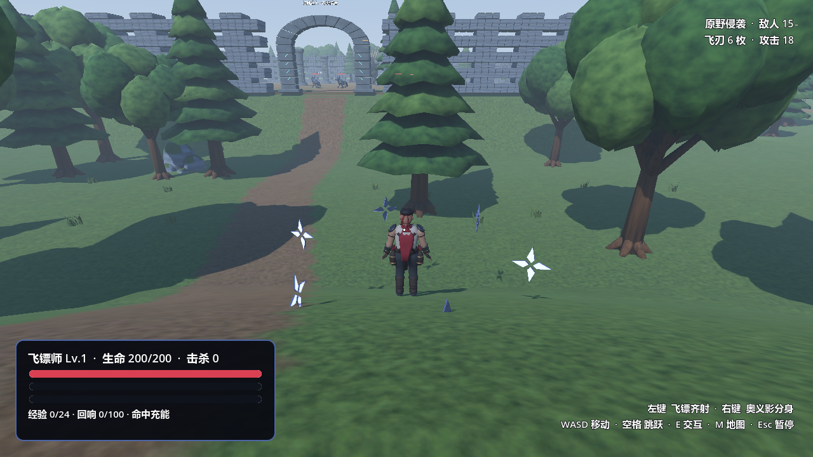

## 飞镖逐枚投出

同一组飞镖依次离开环绕轨道，向目标飞行。

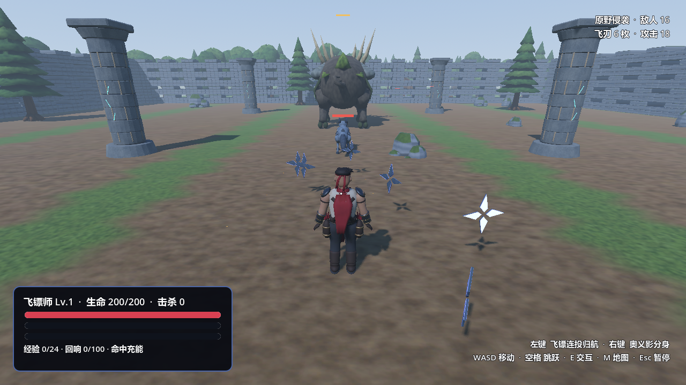

## 命中反馈

飞镖命中敌人时的火花与亮光。

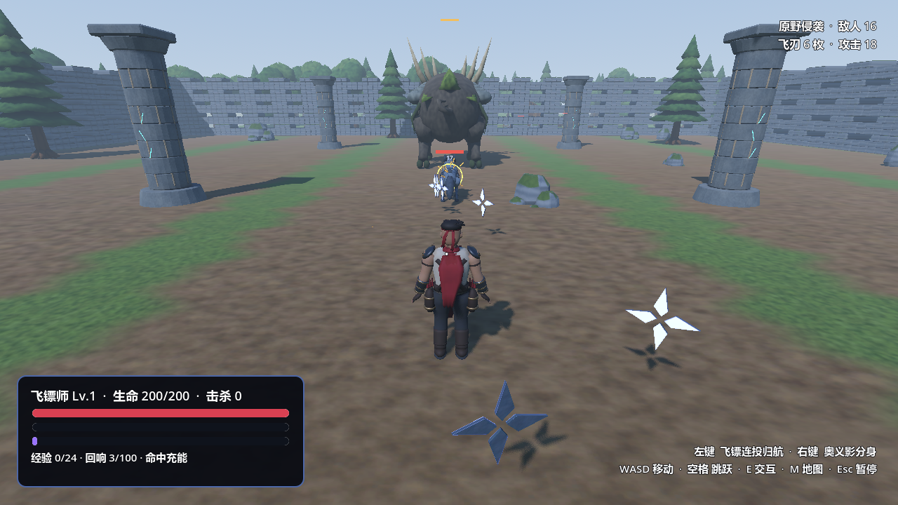

## 飞镖归航

投出的飞镖返回角色附近，重新进入环绕轨道。

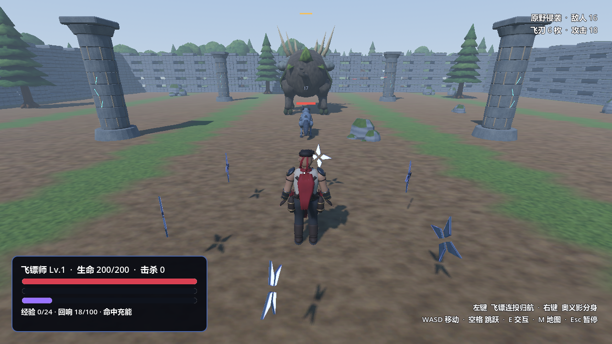

## 跳跃

角色腾空时的第三人称画面。

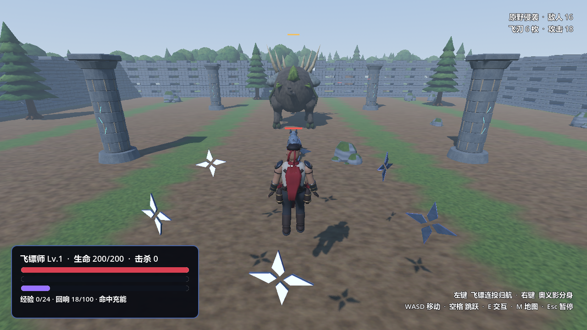

## 升级强化

经验条满后出现三项候选强化，从中选择一项。

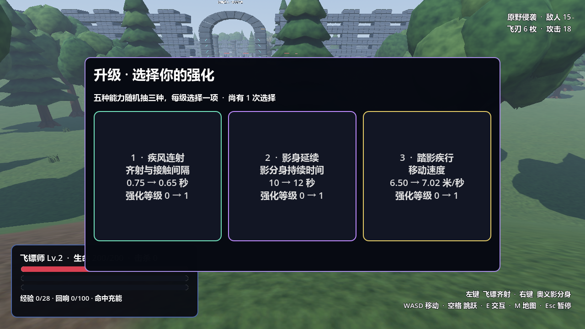

## 奥义·影分身之术

回响满值后召唤影分身，每个分身带有自己的环绕飞镖。

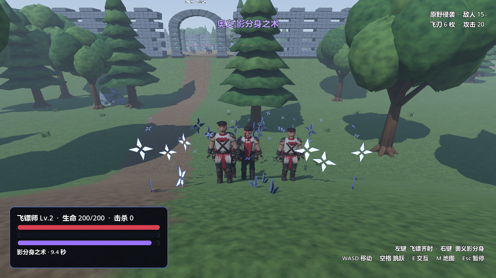

## 苔冠巨兽·双层震波

遗迹竞技场中的巨兽与向外扩散的两层震波。

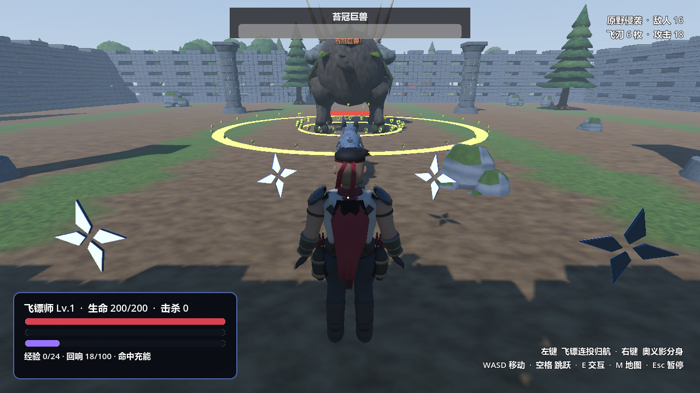

## 苔冠巨兽·根须攻击

地面危险区域与根须突刺。

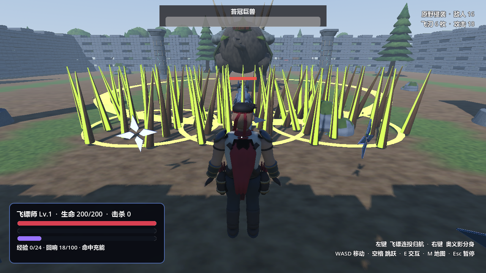

## 森林道路（环境观察镜头）

主世界的树木、草地与道路。

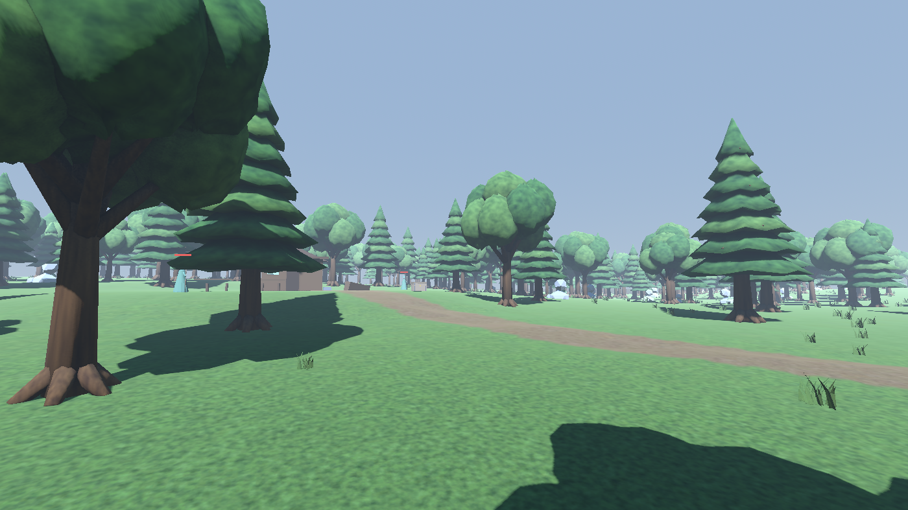

## 巨大飞龙（环境观察镜头）

飞龙在森林上空飞行的游戏运行画面。

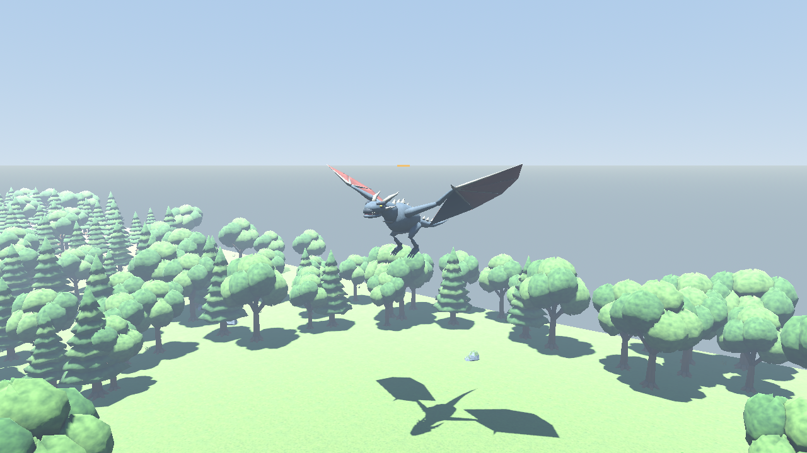
